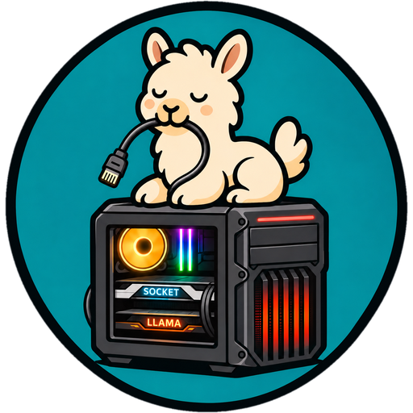

<p align="center">
  
</p>

# socketllama

Use the models that run on your own machine in toptic.ai: Ollama, a LiteLLM proxy (local or
remote), or any other OpenAI-compatible server. Your machine needs no public address.

The client dials **out** to toptic.ai over a WebSocket and keeps the connection open. toptic.ai
sends chat requests down that connection; the client forwards them to the backends you configured
and streams the answers back. Nothing listens on your machine.

```text
         your machine                                      toptic.ai
┌───────────────────────────────┐                  ┌───────────────────────┐
│  Ollama / LiteLLM / ...       │                  │                       │
│            ▲                  │    WebSocket     │                       │
│            │ HTTP             │    (outbound)    │                       │
│  socketllama ─────────────────┼─────────────────►│  gateway ◄── topics   │
└───────────────────────────────┘                  └───────────────────────┘
```

Three words used throughout: a **machine** is one computer running the client (`instance` in the
configuration), a **backend** is a model server the client forwards to, and the **gateway** is
the address at toptic.ai the client connects to.

## Contents

- [Quick start](#quick-start)
- [Setup in detail](#setup-in-detail)
- [Running as a service](#running-as-a-service)
- [Configuration](#configuration)
- [Models in memory (Ollama)](#models-in-memory-ollama)
- [Prices and descriptions](#prices-and-descriptions)
- [What the terminal shows](#what-the-terminal-shows)
- [What the client will and will not do](#what-the-client-will-and-will-not-do)
- [How it behaves](#how-it-behaves)
- [Exit codes](#exit-codes)
- [Development](#development)
- [License](#license)

## Quick start

You need git and Python 3.11 or newer.

1. **Add your machine in toptic.ai.** Open **My Machines** (account menu) and add your machine
   (each computer once). On its page click **Create connection token**. The page now shows a
   config block with the gateway URL, the machine name and its secrets. The token is shown only
   once, so keep the page open. It can only connect your machines, and you can see and revoke
   your tokens under Profile → API tokens.

2. **Install the client** from its git repository (the machine's page links it):

   ```bash
   git clone https://github.com/toptic-ai/SocketLlama.git socketllama
   cd socketllama
   python3 -m venv .venv
   .venv/bin/pip install -e .
   ```

3. **Run setup** in a terminal. Paste the config block when asked, choose the models to share,
   and let it write `config.toml`:

   ```bash
   .venv/bin/socketllama setup
   ```

4. **Run the client**, unless setup already started it for you:

   ```bash
   .venv/bin/socketllama run -c config.toml
   ```

   The terminal shows `Connected to ... as machine <name>` and the machine's page shows
   "Connected" with your models.

While the client is connected, your models appear in toptic.ai's model picker in a group headed
by the machine's name, for example "Home GPU · your machine"; everyone you shared a key of it with
sees "Home GPU · *your name*'s machine" (sharing works on the machine's page, through its API key).
Each model is listed by the name your backend knows it by; with more than one backend, the
backend's name comes first (`ollama/gemma3:4b`). When the client disconnects they disappear from the picker. If toptic.ai refuses the
connection, the machine's page says why and what to fix.

## Setup in detail

### Commands

| Command | What it does |
|---|---|
| `socketllama setup` | Asks for the connection and the models to share, and writes the configuration file |
| `socketllama check` | Validates the configuration and lists each backend with the models it would offer. Talks only to your backends, not to toptic.ai |
| `socketllama run` | Connects to toptic.ai and relays requests |

Each command takes `-c FILE` for the configuration file (default: `config.toml` in the current
directory). `-v` before the command adds debug output (`socketllama -v run`), and
`--version` prints the version.

### What setup asks

Setup explains each step as it goes, and writes nothing before you confirm.

<details>
<summary>The steps of setup</summary>

- **Connection.** Paste the config block from the machine's page (then type `END` on a line of
  its own, or press Ctrl-D), or answer one question at a time; the token and the secret are then
  not shown while you type. Only the `[gateway]` values of the block are used.
- **Models.** Setup looks for Ollama at `http://127.0.0.1:11434/v1` and lists its chat models.
  Choose by number (`1,3-4`), `all` for every model listed now, or `future` to also share the
  models you pull later (`models = []` in the file; setup asks you to confirm that). If Ollama
  does not answer you can try again, enter another address, or skip it. You can add further
  backends (a LiteLLM proxy, another OpenAI-compatible server, an Ollama elsewhere) with their
  address and API key. At least one backend that shares models is needed.
- **Memory.** For an Ollama backend, two more questions, both "no" unless you say otherwise:
  whether its models stay in memory longer than Ollama's 5 minutes after a request, and whether
  the chosen models are loaded when the client starts. See
  [Keeping models in memory](#keeping-models-in-memory).
- **Saving.** Setup shows what it will write (secrets hidden) and writes nothing before you
  confirm. The file is created readable by you only (`chmod 600`). An existing file is replaced
  only after you say so, and kept as `config.toml.backup-<date>-<time>` unless you decline. If
  other users of the computer could read the old file, setup says so: renew the connection token
  and the signing secret on toptic.ai then.
- **Check and start.** Setup then runs the same check as `socketllama check`, prints the
  command that starts the client, and offers to start it right away.

</details>

Only `config.toml` and its backups are git-ignored. A configuration with another name
(`-c other.toml`), and the backups setup keeps of it, hold your secrets too: keep them out of
the checkout or out of your commits.

### Setting up by hand

Where no terminal is available (setup refuses to run without one), write the file yourself:

1. Save the config block of the machine's page as `config.toml` in the checkout and protect it,
   because it holds the token and the signing secret:

   ```bash
   chmod 600 config.toml
   ```

   Replace the `models = [...]` placeholder with the models you want to offer, as `ollama list`
   names them. Instead of keeping the secrets in the file you can use `token_env` and
   `signing_secret_env` (see [`config.example.toml`](config.example.toml)).

2. Check the configuration, then run the client:

   ```bash
   .venv/bin/socketllama check -c config.toml
   .venv/bin/socketllama run -c config.toml
   ```

## Running as a service

The client reconnects by itself and picks up a backend that starts later (at the next models
report, about five minutes), so a service manager only has to start it and restart it after a
crash. Exit codes `2` (configuration error) and `3` (refused by toptic.ai) fail again on every
start: fix the cause first. `load_at_start` runs once: if Ollama is not up yet, models load on
first use.

Run it as the user who owns the checkout and `config.toml`, once per machine, with absolute paths
(setup prints the full start command). The examples assume `~/socketllama`.

### Linux (systemd)

`~/.config/systemd/user/socketllama.service`:

```ini
[Unit]
Description=socketllama

[Service]
WorkingDirectory=%h/socketllama
ExecStart=%h/socketllama/.venv/bin/socketllama run -c %h/socketllama/config.toml
Restart=on-failure
RestartSec=10
RestartPreventExitStatus=2 3

[Install]
WantedBy=default.target
```

```bash
systemctl --user daemon-reload
systemctl --user enable --now socketllama    # start now and at every login
journalctl --user -u socketllama -f          # log
systemctl --user restart socketllama         # after changing config.toml
systemctl --user disable --now socketllama   # stop for good
```

`loginctl enable-linger $USER` keeps it running at boot and after logout. Variables for the
`*_env` options go in a `chmod 600` file named with `EnvironmentFile=` in `[Service]`.

### macOS (launchd)

`~/Library/LaunchAgents/local.socketllama.plist` (launchd does not expand `~`: replace
`/Users/you`):

```xml
<?xml version="1.0" encoding="UTF-8"?>
<!DOCTYPE plist PUBLIC "-//Apple//DTD PLIST 1.0//EN" "http://www.apple.com/DTDs/PropertyList-1.0.dtd">
<plist version="1.0">
<dict>
    <key>Label</key>
    <string>local.socketllama</string>
    <key>WorkingDirectory</key>
    <string>/Users/you/socketllama</string>
    <key>ProgramArguments</key>
    <array>
        <string>/Users/you/socketllama/.venv/bin/socketllama</string>
        <string>run</string>
        <string>-c</string>
        <string>/Users/you/socketllama/config.toml</string>
    </array>
    <key>RunAtLoad</key>
    <true/>
    <key>KeepAlive</key>
    <dict>
        <key>SuccessfulExit</key>
        <false/>
    </dict>
    <key>ThrottleInterval</key>
    <integer>60</integer>
    <key>StandardErrorPath</key>
    <string>/Users/you/Library/Logs/socketllama.log</string>
</dict>
</plist>
```

```bash
launchctl bootstrap gui/$(id -u) ~/Library/LaunchAgents/local.socketllama.plist   # start
launchctl kickstart -k gui/$(id -u)/local.socketllama                            # restart
launchctl bootout gui/$(id -u)/local.socketllama                                 # stop
tail -f ~/Library/Logs/socketllama.log
```

launchd also restarts after exit codes `2` and `3`, once a minute: check the log if the machine
stays offline. Empty the log with `: > ~/Library/Logs/socketllama.log`; do not delete it
while the agent runs. The agent starts at login. To stop it for good, `bootout` it and delete the
plist.

### macOS notes

Running on macOS is untested so far; please report what you find.

- **Python.** The system `python3` is 3.9, which is too old. Install 3.12
  (`brew install python@3.12`, then `python3.12 -m venv .venv`).
- **Ollama.** The app listens on `127.0.0.1:11434` as on Linux. Set its variables with
  `launchctl setenv OLLAMA_KEEP_ALIVE 3h` and restart the app (lost at reboot).
- **Sleep.** A sleeping Mac is offline in toptic.ai. Prevent automatic sleep in the Energy
  settings, or run the client in a terminal under `caffeinate -i`.
- **No Docker.** Inside a container `127.0.0.1` is not the Mac, and Docker on a Mac cannot use
  the GPU.

## Configuration

[`config.example.toml`](config.example.toml) shows every option with a comment. In short:

| Section | What it holds |
|---|---|
| `[gateway]` | The connection to toptic.ai: `url`, `instance`, and the two secrets, `token` and `signing_secret` (or `token_env` and `signing_secret_env` to read them from the environment) |
| `[client]` | Optional. Keep-alive (`ping_interval` 30 s, `pong_timeout` 20 s), reconnect backoff (`reconnect_min` 1 s, `reconnect_max` 60 s) and `max_concurrent_requests` (4; a whole number, at least 1) |
| `[[backends]]` | One entry per model server: `name`, `kind`, `base_url`, `models`, and the options below |

Two rules the client enforces at start (exit code `2` otherwise):

- A file with inline secrets (including a backend's `api_key`) must be readable by its owner
  only (`chmod 600`).
- The gateway `url` must use `wss://`. `allow_insecure = true` permits `ws://`, for a
  development server on localhost. An address that cannot be one (a port that is not a whole
  number from 0 to 65535, or brackets that do not hold an IPv6 address) is refused, for the
  gateway `url` and a backend's `base_url` alike.

### Backends

`base_url` is the OpenAI-compatible API root, the URL that serves `/chat/completions`.

| `kind` | Typical `base_url` | What discovery adds |
|---|---|---|
| `ollama` | `http://127.0.0.1:11434/v1` | The context window requests really get; embedding models are left out |
| `litellm` | `http://127.0.0.1:4000/v1` or a remote proxy | Limits and per-token prices from `/model/info` (falls back to `/models` if the key may not read it) |
| `openai` | Any other compatible server | Model names from `/models` |

| Option | Meaning |
|---|---|
| `models` | Required. Only the listed models are reported and relayed. An empty list, `models = []`, shares every chat model the backend offers, including models pulled later; the client warns about that at start |
| `api_key`, `api_key_env` | Sent to the backend as a bearer token; never sent to toptic.ai |
| `read_timeout` | Seconds the client waits for the backend, for the start of an answer and for each further part of it. Default 600. See [Slow model loads](#slow-model-loads) |
| `context_length` | The context window reported for every model of the backend |
| `keep_loaded`, `load_at_start` | Ollama only. See [Keeping models in memory](#keeping-models-in-memory) |
| `[backends.prices_per_1m_tokens]`, `[backends.descriptions]` | Any kind. See [Prices and descriptions](#prices-and-descriptions) |

<details>
<summary>Which context window an Ollama backend reports</summary>

Without `context_length`, an Ollama backend reports the window Ollama uses for API requests: that
of the loaded model (`/api/ps`), else the Modelfile's `num_ctx`, else Ollama's default of 4096.
It is never the architecture's maximum, which Ollama does not use unless configured to.

If you raised `OLLAMA_CONTEXT_LENGTH`, set `context_length` to the same value; it is still capped
at what the model supports. toptic.ai plans prompts within this window, so overstating it makes
Ollama silently cut long conversations from the front.

Each such window is reported with where it comes from (`context_length_source`): `configured`
(the backend's `context_length`), `loaded` (the model in memory), `modelfile` (its `num_ctx`) or
`default` (none of these: Ollama's default, capped like the others where the model supports less;
also when Ollama gives no details of the model). Ollama's API does not tell the server's
`OLLAMA_CONTEXT_LENGTH`, so a `default` window may be smaller than the one requests get. That is
why toptic.ai, while a model is out of memory and reported with `default`, keeps the window it
last saw for it as `loaded`; a `configured`, `modelfile` or `loaded` window replaces it. When a
model comes into memory, or Ollama loads it again with another window, the client sends a fresh
report soon, within toptic.ai's limit of one a minute (with a toptic.ai that is told what is in
memory, see [Which models are in memory](#which-models-are-in-memory)).

So after you lower `OLLAMA_CONTEXT_LENGTH`, or create a model again with a smaller `num_ctx`,
toptic.ai keeps planning with the window it last saw loaded until the model has been loaded again,
usually about a minute after the next request. Setting `context_length` for the backend pins the
window instead.

</details>

## Models in memory (Ollama)

Ollama takes a model out of memory five minutes after its last request, and the next prompt
waits until it is loaded again. This part is about what the client does around that. All of it
applies to backends of kind `ollama` only: a LiteLLM proxy or another server has no memory the
client could speak to.

### Keeping models in memory

Two optional settings of an Ollama backend. Without them Ollama alone decides. On a backend of
another kind they are a configuration error.

```toml
[[backends]]
name = "ollama"
kind = "ollama"
base_url = "http://127.0.0.1:11434/v1"
models = ["llama3.1:8b", "qwen3:14b"]
keep_loaded = "2h"        # after a request through toptic.ai, the model stays this long
load_at_start = true      # load both models when the client starts
```

**`keep_loaded`** takes what Ollama's `keep_alive` takes: a time (`"30m"`, `"2h"`, `"1h30m"`), a
number of seconds, or a negative number (`-1`) for as long as Ollama runs. A model in memory
occupies RAM, or VRAM on a graphics card, for all that time. Two values need care:

- `0` unloads the model after every answer, so each prompt through toptic.ai waits for the
  model to be loaded again.
- `-1` keeps the model until Ollama stops. Its memory stays taken, also when nobody has used
  the model for days.

**`load_at_start`** loads the listed models, one after another, once the client is connected and
has reported its models. The models are on offer while they load, and a client that toptic.ai
turns away loads nothing. A model that does not fit or was never pulled is a warning; the client
goes on. It needs the models listed: with `models = []` it is refused, because loading whatever
the server has may not fit into its memory.

`socketllama check` shows both settings for every Ollama backend.

<details>
<summary>How keep_loaded works, and what it does not cover</summary>

Ollama's OpenAI-compatible endpoint, which the client relays to, has no field for this. So when a
relayed request that got an answer is over (finished, cancelled or broken off), the client sends
Ollama a request of its own: `POST /api/generate` with the model's name, `keep_alive` and no
prompt.

- Only for a model `/api/ps` lists as in memory, so this never loads one.
- It never delays an answer, and a refusal by Ollama is logged once, not with every request.
- At most one such request at a time for a model of a backend, with a time limit of 15 seconds.

Not covered: a request that reaches Ollama another way (the `ollama` command, another program)
sets Ollama's own time again, until the next request through toptic.ai. And a model Ollama took
out of memory right after an answer (it is set to unload at once, or needed the room for another
model) is not loaded again. Loading another model later can still push a kept model out.

</details>

<details>
<summary>More about load_at_start</summary>

- It runs once per start of the client, not again after a reconnect.
- Once loading is over, the client sends a fresh models report with the context window Ollama
  gave each loaded model (unless the backend sets `context_length`).
- The log says what is loaded, how long each model took, and what is in memory at the end.
- With `keep_loaded` the models stay that long; without it as long as Ollama keeps them, so they
  are gone after five minutes without a request.
- Ollama keeps at most 3 models in memory for each GPU (3 without one) unless
  `OLLAMA_MAX_LOADED_MODELS` is set on the server. With more models listed than that, loading
  one takes out another. The client cannot see the server's setting.

</details>

<details>
<summary>keep_loaded or OLLAMA_KEEP_ALIVE?</summary>

`OLLAMA_KEEP_ALIVE` is an environment variable of the Ollama server. It applies to every model
and every request, also those that do not come through toptic.ai. Use it when the machine is
there to serve models and everything should stay loaded the same way.

Use `keep_loaded` when only what is shared through toptic.ai should stay longer, or when you
cannot or do not want to change how the server is started. If both are set, `keep_loaded`
decides after a request through toptic.ai and `OLLAMA_KEEP_ALIVE` after every other one.

</details>

### Slow model loads

A large model on a slow disk can take minutes to load, and nothing of the answer comes before it
is in memory. The client does three things about that, without any setting:

| What | In short |
|---|---|
| It waits as long as toptic.ai does | toptic.ai 0.20 or newer says at connect how long it waits for a model to load (the terminal shows it: `toptic.ai waits up to 900 s for a model to load`). For a prompt whose model was not in memory, the client waits at least that long for the answer to begin |
| It finishes a load that was given up | When a request is closed before Ollama began its answer, Ollama drops the load. The client then asks Ollama to load the model itself, so the next prompt finds it in memory |
| It says "still loading" as such | While a model loads, Ollama refuses prompts with a server error. The client tells toptic.ai that the backend is still loading a model (error code `backend_model_loading`), so the person can be told to try again shortly. Every other error answer of a backend is passed on unchanged |

A model that takes longer to load than the client waits (longer than toptic.ai's time, or with an
older toptic.ai longer than 600 seconds) needs a larger `read_timeout`. Otherwise the client gives
up and Ollama drops the load again. toptic.ai's own wait is not changed by it.

```toml
[[backends]]
name = "ollama"
kind = "ollama"
base_url = "http://127.0.0.1:11434/v1"
models = ["deepseek-r1:32b"]
read_timeout = 1200       # seconds: room for a model that takes a quarter of an hour to load
```

`read_timeout` is also how long the client waits for each part of an answer, so a backend that
stalls in the middle of one is given up on that much later.

<details>
<summary>The waits in detail</summary>

- toptic.ai waits its longer time once the client told it that the model is not in memory. The
  client waits on the same condition: for a prompt whose model Ollama did not list as in memory
  (`/api/ps`), it waits at least that long for the answer to begin, also where the backend's
  `read_timeout` is shorter. Where `read_timeout` is longer, it applies.
- Every other wait is `read_timeout`: for a model that was in memory, for a backend of another
  kind, and for each further part of an answer that has begun.
- A time toptic.ai gives above an hour counts as an hour (a `WARNING` says so).
- An older toptic.ai says nothing, and `read_timeout` bounds the wait for a loading model too.
- Not covered: a prompt that arrives while Ollama is already loading its model for another
  request. Ollama lists a model as in memory from the moment it starts to load it, so the client
  reports nothing, toptic.ai waits only its usual time, and the client its `read_timeout`.

</details>

<details>
<summary>Finishing a load in detail</summary>

Ollama ties the loading of a model to the request that made it necessary: when that request is
closed before the model is in memory, Ollama gives the load up, and the next prompt starts from
nothing. A request is closed like that when toptic.ai cancels it (the person stopped it, or
toptic.ai's own wait ran out), when the connection to toptic.ai ends, or when the client's own
wait runs out.

If Ollama had not begun its answer by then, and did not list the model as in memory before the
prompt went to it, the client asks Ollama for the load right after the request was closed: the
same request `load_at_start` uses, with the backend's `keep_loaded` if it has one, and the same
wait as for a prompt whose model was not in memory. The terminal says so, and later that the
model is in memory and after how long, or why it could not be loaded (a `WARNING`).

- One load per model at a time. The client's own loads go to Ollama one after another, and
  stopping the client ends them.
- Nothing is loaded for a backend with `keep_loaded = 0` (the model would not stay), or when the
  client did not learn what was in memory: it asks Ollama only for a toptic.ai that takes
  progress before the answer (see [How it behaves](#how-it-behaves)), and claims nothing when
  `/api/ps` cannot be read.
- Ollama may have loaded the model by then and been busy with a long prompt. The load asked for
  is then answered at once and changes nothing.

</details>

### Which models are in memory

A prompt to a model Ollama has in memory is answered at once; one to a model that is not waits
until it is loaded. So the client tells toptic.ai which of your shared models each Ollama backend
holds in memory right now, and toptic.ai can show it. This needs a toptic.ai that supports it (it
says so when the client connects); an older one gets nothing of it.

**Privacy.** Everyone you share the machine with sees which of its shared models are in memory,
including models you used yourself on the machine (with the `ollama` command or another program),
not only through toptic.ai. If you do not want that, switch it off on the machine's page in
toptic.ai.

<details>
<summary>What is told, and when</summary>

**What.** For every Ollama backend, the models of the models report that Ollama's `/api/ps`
lists. Models you do not share, and embedding models, are never named. A backend with nothing
loaded is told as such. A backend whose `/api/ps` cannot be read, or whose models the last
report could not check, is left out: what it holds is unknown then (that is logged once, until
it works again).

**When.** Once after connecting, right after the first models report, and again after every
reconnect. After that only when something changed. The client looks every minute, right after an
answer through toptic.ai ended, and once `load_at_start` is over. It sends at most one such
message every 5 seconds: changes that come quicker are sent together, as one message with the
latest state.

**And a fresh models report.** When one of these checks finds a model in memory with another
window than the last models report carried for it as loaded, on a backend without
`context_length`, the client also sends a fresh models report, with the window Ollama gave the
model, as soon as toptic.ai takes one again (at most one a minute). That is a model that came into
memory, or one Ollama loaded again with another window. A model that leaves memory does not.

</details>

## Prices and descriptions

Each model of your machine can have two things the people you share it with see:

- A **price**, in USD per 1M tokens of the prompt (`input`) and of the answer (`output`). It
  counts against the quotas you give them; toptic.ai bills nobody. Until a price is set, a model
  costs what its backend reports: nothing for Ollama, LiteLLM's own price for a model of a proxy.
- A **description**: one line that says what the model is good for.

Both can be set in two places, and both places end up showing the same: on the machine's page in
toptic.ai (My Machines), or in `config.toml`, in a table at the end of the backend's entry:

```toml
[[backends]]
name = "ollama"
kind = "ollama"
base_url = "http://127.0.0.1:11434/v1"
models = ["llama3.1:8b", "qwen3:14b"]

# Prices in USD per 1M tokens. toptic.ai keeps these lines up to date.
[backends.prices_per_1m_tokens]
"llama3.1:8b" = { input = 0.80, output = 2.00 }

# What each model is good for, as toptic.ai shows it. toptic.ai keeps these lines up to date.
[backends.descriptions]
"llama3.1:8b" = "Quick answers to short questions, in English and German"
"qwen3:14b" = "Careful reasoning; slower, give it time"
```

The rules:

- A price needs both numbers, each from 0 to 1000.
- A description is one line of 1 to 500 characters, without control characters (a tab, a line
  break) or characters that change the writing direction. toptic.ai holds it to the same rule.
- A name must be one of the backend's `models` (any name, with `models = []`): another is
  refused as a typo.
- Both tables come at the end of the backend's entry, in either order.
- `check` shows the price and the description of each model, and names a priced or described
  model the backend does not offer now.

### Which value counts

toptic.ai holds the price and the description, and the edit that reaches it last counts,
wherever it was made.

- **Set on the machine's page:** the running client writes it into `config.toml` at once, and
  its next models report confirms it. One set while the machine is off is written after the
  client starts and has reported what the file holds.
- **Changed in `config.toml`:** the client reads the file once, when it starts. A line you change
  counts when you restart the client: it reports the line, and toptic.ai takes it as the newest
  edit. So if you set a value on the page while the machine is off and also change the line
  before the client starts again, the line wins.
- **Removing a line resets nothing:** the value in force is written back. To make a model free,
  write 0, or set it on the page.
- **After `setup`:** setup writes a file without these lines; after the next start they come
  back. The values stay in force on toptic.ai meanwhile.

<details>
<summary>How the client writes config.toml</summary>

- Only the model's line changes, or is added (with the table, at the end of the backend's entry,
  if it has none). Every comment and the rest of the layout stay as they are.
- Before writing, the client checks that the new text reads as the old file with exactly this
  one value changed.
- A layout it does not follow is left alone: dotted keys such as `"llama3.1:8b".input = 0.8`, a
  table per model, the prices as an inline table on the backend, or a description written as a
  string over several lines (`"""`).
- The file is replaced as a whole, never half-written, and keeps its permissions and its group.
  A symbolic link is followed and stays one. A file that belongs to another user, or whose group
  the client may not give the new file, is left alone.
- Before the first price or description of each run of the client is written, the file is
  copied to `config.toml.backup-<date>-<time>`, readable by you only, as setup does.
- A description is written as a TOML string that reads back as exactly what toptic.ai holds; a
  character a terminal does not show as such is written as its escape (a no-break space as
  `\u00A0`).

</details>

<details>
<summary>When a value is not written</summary>

- **The file cannot be written.** If `config.toml` or its folder is not writable, the file is
  not valid TOML at that moment (you are editing it), or the check before writing fails, nothing
  is written. The client warns once per model and value, with the line to put in by hand. The
  value stays in force on toptic.ai, which offers it again at every report.
- **You changed the line while the client runs.** A value toptic.ai sends for that model is not
  written over your line: restart the client, and your line is reported and counts.
- **toptic.ai has not seen the file yet.** The client writes a value only for a model that a
  models report of this run listed and toptic.ai acknowledged. Otherwise a line changed while
  the client was not running could be written over before it was reported. The answer to a
  report that lists the model brings the value again.
- **The value is not valid.** toptic.ai may send a price and a description of a model together.
  Each is taken for itself: a description that is too long, say, is ignored with a `WARNING`,
  and the price beside it is written all the same.
- **An older toptic.ai** that does not take prices or descriptions from the machine (it says so
  when the client connects) is told none, and the client writes none. If `config.toml` holds
  some, the client says once that they are not reported.

</details>

<details>
<summary>The exact rule for a description</summary>

A description has 1 to 500 characters (Unicode code points; the blanks around it do not count).
It may not hold control characters (a tab, a line break), the separators of lines and of
paragraphs (U+2028, U+2029), or the controls of writing direction (U+200E, U+200F, U+061C,
U+202A to U+202E, U+2066 to U+2069), which would let a description reorder the model's name next
to it on toptic.ai's pages. Everything else is fine: every kind of space (a no-break space too),
letters and emoji of any script, joiners, a soft hyphen.

</details>

## What the terminal shows

While it runs, the client shows one line per event that matters, each starting with the local
time. A line about a problem names its level (`WARNING`, `ERROR`); the others do not. For
example:

```text
2026-11-19 21:04:12 Connected to wss://toptic.example/ws/socketllama/ as machine home-gpu
2026-11-19 21:04:12 Reported to toptic.ai: ollama 3 models
2026-11-19 21:04:12 toptic.ai registered the 3 models reported: no changes
2026-11-19 21:04:13 In memory now: ollama qwen3:14b
2026-11-19 21:06:40 #1 prompt from Alice Example for ollama/deepseek-r1:32b: 4 messages, 6,212 characters
2026-11-19 21:06:40 #1 ollama/deepseek-r1:32b is not in memory: Ollama loads it first
2026-11-19 21:07:31 #1 done after 51.2 s, 1,874 prompt tokens, 912 answer tokens
2026-11-19 21:07:31 In memory now: ollama deepseek-r1:32b, qwen3:14b
2026-11-19 21:09:02 #2 prompt from unknown user for ollama/qwen3:14b: 1 message, 38 characters
2026-11-19 21:09:05 #2 cancelled after 3.1 s: stopped by toptic.ai
2026-11-19 21:12:44 WARNING Connection to the gateway closed (code 1006); reconnecting in 0.8 s
2026-11-19 21:12:45 Connected to wss://toptic.example/ws/socketllama/ as machine home-gpu
```

| Lines about | What they say |
|---|---|
| The connection | Connecting, with the machine's name. A lost connection and the wait before the next attempt. A refused connection, with toptic.ai's reason and what to do about it (the client stops then) |
| Models | The models report sent to toptic.ai, with the number of models of each backend, and toptic.ai's answer with what it changed. A refresh every five minutes that changes nothing shows neither. What `load_at_start` loads, and how long each model took |
| Memory | With a toptic.ai that is told about it: the models each Ollama backend holds in memory, whenever that changes |
| A prompt | Its number (`#1`), who sent it, the model as backend and model name, and its size: messages, characters of their text, and attachments (images, files) |
| The end of an answer | `done`, `cancelled` or `error` (a `WARNING`), with how long it took since the prompt arrived, and the token counts if the backend reports them |
| A streaming answer | `paused` when toptic.ai takes the answer more slowly than it comes, `resumed` when it goes on. With a toptic.ai that is told this: that a model is not in memory and Ollama loads it first |
| Slow loads | Once, how long toptic.ai waits for a model to load, if it says so. That the client has Ollama load a model after a prompt ended without an answer, and how that went. That Ollama refused a prompt because it is still loading a model |
| Prices and descriptions | At start, what `config.toml` holds. Each value toptic.ai set that was written into the file, and where the file was copied before the first one. A value that could not be written is a `WARNING` with the reason and the line to put in by hand |

**Never shown**, also not with `-v`: the text of a prompt or of an answer, the API token, the
signing secret or a backend's API key.

**Privacy.** The names in the prompt lines are those of the people you share the machine with
(and yours, for your own prompts): toptic.ai sends the name it shows of the person, never an
email address. Only you see them, on the computer the client runs on, and in its log if you keep
one. toptic.ai says so on the share page of the machine's keys.

<details>
<summary>More about these lines</summary>

- **Numbers.** Each prompt gets a number for this run of the client, so the lines of prompts
  answered at the same time can be told apart.
- **Who sent it.** "unknown user" when toptic.ai sends no name, as an older one does.
- **Cancelled** means stopped by toptic.ai, for example because the person stopped the answer,
  or because the connection ended.
- **Token counts** come from the backend; the client counts no tokens itself. Ollama, LiteLLM
  and most other servers report them.
- **Errors.** An error gives the backend's HTTP status and the kind of error it named, for
  example `HTTP 404 from ollama (not_found_error)`, or that the backend could not be reached.
  The backend's own words about it are shown with `-v` only: a server may quote the prompt in
  them.
- **Pauses.** `paused` and `resumed` are shown once per answer; further pauses of the same
  answer with `-v`.
- **Only with `-v`:** pings, the stages reported to toptic.ai while an answer is on its way, the
  checks of memory every minute that find nothing changed, the details of discovery, and a trace
  of every WebSocket frame (as type and size only).
- **Where the lines go.** To the standard error output, as plain text without colours, for a
  terminal, a service's journal or a log file alike.
- **Banner.** `run` and `setup` show a banner when they start on a terminal, sized to its width.
  It is never printed when the output is piped or the client runs under a service manager, so it
  never ends up in a log.

</details>

## What the client will and will not do

toptic.ai is trusted to route requests, not to choose what your machine does.

- **Nothing listens.** The client only opens connections: one out to toptic.ai, and those to
  your backends.
- **Only your backends.** A request names a backend from your configuration. It cannot carry a
  URL, a host or a header, so toptic.ai cannot make the client call anything else on your
  network.
- **Only chat requests.** Only `POST /chat/completions` is forwarded. Model management
  (pulling or deleting models, LiteLLM key management) is unreachable.
- **Only the models you share.** Requests for other models are refused, and other models are not
  even reported. Sharing everything takes an explicit `models = []`.
- **Signed requests.** Every request carries an HMAC made with the machine's signing secret over
  the request and the nonce toptic.ai sent when this connection started. Requests with a wrong
  or missing signature, requests signed for an earlier connection, and request ids already seen
  on the connection are refused. A stolen connection token alone is not enough to drive your
  backend, and a recorded request cannot be played back later.
- **Proof of the secret at connect.** The client answers toptic.ai's nonce with an HMAC made
  with the signing secret, so the token alone does not let anybody else register as your
  machine. The secret itself is never transmitted.
- **Credentials stay local.** Backend API keys are added by the client and never sent to
  toptic.ai. Of a backend's response only the status, the content type and the body are passed
  on.
- **Secrets and prompts are never logged.** Neither the token, the signing secret or a backend's
  API key, nor the text of a prompt or of an answer, also not with `-v`. A configuration file
  with inline secrets must be `chmod 600`, or the client refuses to start.
- **Only prices and descriptions are written.** What toptic.ai can change in `config.toml` is
  the price line and the description line of a model a backend shares, within the bounds the
  configuration allows, through an editor that verifies that nothing else changed. It cannot
  touch the token, the signing secret, a backend, an address or the list of models.

**What it does not protect against.** Prompts and attached documents of the people you share a
key of your machine with are processed on it. And whoever holds both your connection token and
your signing secret can register as your machine and receive those prompts. If in doubt, create
a new signing secret on the machine's page and revoke the token (Profile → API tokens).

## How it behaves

- **Reconnect.** A lost connection is retried with exponential backoff and jitter
  (`reconnect_min` doubling up to `reconnect_max`). The backoff starts over after a connection
  that lasted at least a minute.
- **Refused for good.** Rejected credentials, an unknown machine, an incompatible protocol
  version, or credentials revoked while connected (token deactivated or expired, signing secret
  regenerated, machine deleted or deactivated in toptic.ai) stop the client with exit code `3`:
  retrying would not help.
- **Second client.** If another client connects for the same machine, it takes over. This one
  logs that and retries every five minutes. Stop one of them to end the back and forth.
- **Keep-alive.** A ping every `ping_interval` seconds; no pong within `pong_timeout` drops the
  connection and reconnects.
- **Streaming.** Response bytes are forwarded as they arrive. toptic.ai can pause, resume and
  cancel a request; cancelling aborts the call to the backend.
- **Models.** Reported on connect and every five minutes, so newly pulled models show up without
  a restart.

<details>
<summary>Models reports in detail</summary>

- A reconnect within a minute of a report toptic.ai acknowledged does not repeat an unchanged
  report. If toptic.ai does not acknowledge the first report of a connection, the client sends
  it again a minute later instead of waiting for the next refresh.
- A report holds at most 8 backends with 200 models each (toptic.ai's limits, mirrored in
  `protocol.py`). Models beyond that are left out and named in a warning.
- **A backend that cannot be checked.** If a backend's discovery times out (after 15 s, for
  example because the backend is busy loading a model) or gets an answer that cannot be used,
  the report marks it as not checked instead of reporting it without models. toptic.ai then
  keeps its models listed for a while, so they do not disappear for one busy moment. If the
  backend stays silent longer, they are deactivated like models it no longer offers.
- **A backend that is down** (it refuses the connection, or its host name does not resolve) is
  reported without models, and its models leave the list at once.

</details>

<details>
<summary>Progress before the answer</summary>

While the backend has not started its answer, the client tells toptic.ai that the request was
received, and for Ollama whether the model was in memory. It asks `/api/ps` once per request,
before the prompt goes to Ollama (and waits at most five seconds for that). A model missing there
has to be loaded first, which the topic shows.

A listed model is not necessarily ready (Ollama has no loading state), and if `/api/ps` cannot be
read nothing is claimed. Only the stage names travel, no text of the client. This needs a
toptic.ai that takes it (it says so when the client connects).

</details>

## Exit codes

| Code | Meaning |
|---|---|
| `0` | Stopped by a signal (Ctrl-C, `SIGTERM`), `check` went through, or setup wrote the configuration (also when it is stopped after that, during the check or at the offer to start the client) |
| `2` | Configuration error (also: setup cannot write the file) |
| `3` | Refused by toptic.ai |
| `4` | Setup ended without writing anything (Ctrl-C, end of input, or declined) |
| `5` | Setup started without a terminal |

## Development

```bash
.venv/bin/pip install -e '.[test]'
.venv/bin/python -m pytest
```

The tests run the real client against a fake gateway (a local WebSocket server speaking the
tunnel protocol) and a fake OpenAI-compatible backend (a local HTTP server that mimics Ollama's
and LiteLLM's endpoints, including SSE streaming). No network access and no real backend is
needed.

### Protocol

`src/socketllama/protocol.py` mirrors `ai_helper/service/socketllama_protocol.py` in the
toptic.ai repository. Both test suites pin the same signature test vector; change the protocol
on both sides together.

- **An incompatible change** bumps `PROTOCOL_VERSION`. Both sides refuse a peer with another
  one.
- **An addition the other side may lack** is a capability. The gateway announces what it takes
  in `auth_ok`, and the client uses it only when announced. The client announces what it takes
  in `auth` (`request.user`: the name of the person asking, in each request frame), and the
  gateway sends it only when announced.
- **Announced by both sides:** `models.prices` (the prices of `config.toml` in each models
  report, and `models.settings` frames with the prices toptic.ai holds) and
  `models.descriptions` (the same for descriptions, in the same reports and frames). Each works
  only when both announced it.
- **Without a capability**, since a peer from before it just ignores it: `auth_ok` may say how
  long the gateway waits for a model to load (`model_loading_timeout_seconds`),
  `response.error` has the code `backend_model_loading`, and each model of an Ollama backend in a models report
  says where its context window comes from (`context_length_source`, see [Backends](#backends)).

Both sides keep working with a peer from before a capability. The docstring of `protocol.py`
describes each one.

## License

GNU Affero General Public License v3.0 only (`AGPL-3.0-only`). See [LICENSE](LICENSE).

Copyright © 2026 Jakob Bolliger / toptic.ai
